# AI Event-Driven US Stock Trading System

> **실시간 금융 데이터 피드와 LLM(GPT-4o-mini) 퀀트 분석, Kafka 비동기 파이프라인을 결합한 해외주식 이벤트 드리븐 자동 매매 시스템**

---

## 1. 프로젝트 개요 (Project Overview)

본 프로젝트는 단순한 단일 스크립트 기반의 매매를 넘어, **대용량 이벤트 처리, 마이크로서비스(MSA) 분리, 시스템 신뢰성(동시성 제어 및 멱등성 보장, 장애 격리)**을 검증하기 위해 설계된 백엔드 트레이딩 플랫폼입니다.

미국 주식 시장(NASDAQ/NYSE)의 실시간 시세 및 금융 뉴스 이벤트를 감지하여, 전문 퀀트 페르소나를 탑재한 **AI 의사결정 워커(Python)**가 포지션(BUY/SELL/HOLD), 목표가, 손절가를 산출하고, **Core Trading Engine(Java/Spring Boot)**이 비동기 이벤트 스트림을 소비하여 한국투자증권(KIS) 해외주식 API를 통해 주문을 안전하게 체결합니다.

---

## 🏛️ 2. 시스템 아키텍처 (System Architecture)

```mermaid
flowchart LR
    subgraph Data_Source ["Market & News Feeds"]
        YF["Yahoo Finance RSS / yfinance"]
    end

    subgraph AI_Worker ["AI Signal Worker (Python 3.12)"]
        Scanner["Market & News Scanner"]
        LLM["GPT-4o-mini (Structured Outputs)<br/>- Action: BUY / SELL / HOLD<br/>- Confidence Score<br/>- Stop-Loss / Take-Profit"]
        Dedup["News Deduplication Filter"]
    end

    subgraph Broker ["Message Broker (Kafka / Docker)"]
        Kafka["Topic: stock-signals<br/>(Event Buffering & Fault Isolation)"]
    end

    subgraph Engine ["Core Trading Engine (Spring Boot 3.3)"]
        Consumer["StockSignalConsumer<br/>(Idempotency & Cooldown Cache)"]
        OrderService["KisOrderService<br/>- Simulation Mode (Safe Dry-Run)<br/>- Real Order Execution (TTTT1002U / TTTT1006U)"]
    end

    subgraph External ["External Broker API"]
        KIS["한국투자증권(KIS) 해외주식 API"]
    end

    YF --> Scanner
    Scanner --> LLM
    LLM --> Dedup
    Dedup -->|Confidence >= 0.70| Kafka
    Kafka --> Consumer
    Consumer --> OrderService
    OrderService -.->|Simulation Mode: OFF| KIS
```



---

## 3. 핵심 기술

### ① 실제 AI 에이전트 기반의 퀀트 의사결정 파이프라인
- **실시간 데이터 취합**: `yfinance`와 Yahoo Finance 실시간 RSS를 통해 관심 종목의 현재가, 당일 등락률, 최신 뉴스를 실시간 파싱.
- **구조화된 의사결정 (Structured Outputs)**: Pydantic 스키마를 통해 `BUY/SELL/HOLD`, `Confidence`, `Order Price`, `Stop-Loss`, `Take-Profit`, `Reason`을 정형화된 JSON 형태로 추론.
- **노이즈 필터링**: 일상적인 시황 기사는 `HOLD`로 필터링하고, 확신도(Confidence >= 0.70) 조건을 충족하는 고확신 이벤트에만 주문 시그널 발행.

### ② 이벤트 기반 아키텍처(EDA)를 통한 장애 격리
- AI 워커와 주문 실행 엔진을 **Kafka 메시지 브로커**로 물리적으로 격리.
- 증권사 API 점검이나 일시적 장애 발생 시에도 이벤트 버퍼링을 통해 메시지 유실 방지.

### ③ 멱등성(Idempotency) 및 중복 주문 방지 (Rate Limiting)
- 동일 종목에 대해 짧은 시간 내 중복 신호가 유입될 경우를 대비하여 **주문 쿨다운 캐시(Cooldown Cache)** 기반의 멱등성 보장 로직 구현.

### ④ 안전한 시뮬레이션(Dry-Run) 모드 지원
- 계좌 잔고가 충전되지 않았거나 개발/테스트 단계에서도 비즈니스 로직 전 과정을 안전하게 검증할 수 있는 `trading.simulation-mode: true` 지원.
- 실전 매매 전환 시 `simulation-mode: false` 설정만으로 실계좌 주문 전송 가능.

---

## 4. 기술 스택

| 영역 | 기술 스택 |
| :--- | :--- |
| **Core Trading Engine** | Java 17, Spring Boot 3.3.4, Spring Kafka, Lombok, RestTemplate |
| **AI Signal Worker** | Python 3.12, OpenAI API (`gpt-4o-mini`), Pydantic v2, yfinance, feedparser, confluent-kafka |
| **Infrastructure** | Apache Kafka, Zookeeper, Redis 7.0, Docker & Docker Compose |
| **External API** | KIS(한국투자증권) 해외주식 Open API, Yahoo Finance |

---

## 5. 실행 및 테스트 방법 (Quick Start)

###  1. 클라우드 서버로 웹에 띄우기
> 내 컴퓨터를 꺼도 클라우드(AWS, Oracle Cloud 등)에서 Kafka, Redis, Spring Boot, AI Worker, 웹 대시보드가 단 한 줄로 모두 실행됩니다.

```bash
# 1. 저장소 클론
git clone https://github.com/woooore/ai-event-driven-trading.git
cd ai-event-driven-trading

# 2. OpenAI API 키 설정
cp ai-signal-worker/.env.example ai-signal-worker/.env
# ai-signal-worker/.env 파일에 본인의 OPENAI_API_KEY 입력

# 3. 전체 시스템 원클릭 백그라운드 구동!
docker-compose up -d --build

# 4. 브라우저에서 웹 대시보드 접속: http://{서버IP}:8080
```

---

### 2. 로컬 개발 분리

#### Step 1. 인프라 실행 (Docker)
```bash
docker-compose up -d zookeeper kafka redis
```
> Kafka(9092), Zookeeper(2181), Redis(6379)가 백그라운드로 실행됩니다.

#### Step 2. Core Trading Engine 실행 (IntelliJ)
1. IntelliJ에서 `core-trading-engine` 프로젝트 오픈
2. `src/main/resources/application.yml` 확인 (`simulation-mode: true` 기본값 설정)
3. `CoreTradingEngineApplication.java` 실행
4. 브라우저에서 `http://localhost:8080` 웹 대시보드 오픈

#### Step 3. AI Signal Worker 실행 (Python)
```bash
cd ai-signal-worker

# 24시간 실시간 무한 모니터링 데몬 실행 (시총 50위 감시)
.\venv\Scripts\python.exe analyzer.py --loop --interval 60

# 또는 즉시 매수 연동 테스트용 가상 시그널 발송
.\venv\Scripts\python.exe analyzer.py --test-fire --ticker AAPL
```

---

## 6. Kafka 메세지 스택

```json
{
  "ticker": "NVDA",
  "stock_name": "NVIDIA Corporation",
  "exchange": "NASD",
  "action": "BUY",
  "confidence": 0.92,
  "order_price": 135.50,
  "stop_loss": 128.00,
  "take_profit": 150.00,
  "sentiment": "POSITIVE",
  "reason": "NVIDIA announces record hyperscaler enterprise AI demand with upgraded quarterly revenue guidance."
}
```
